# Smart Assistive Keyboard — A Driverless HID Typing Interface for Motor-Impaired Users

**1st Place, Research Paper Presentation — MICA 2026 · Department of Electronics and Communication Engineering, SRM Institute of Science and Technology, Ramapuram, Chennai**

[](LICENSE)
[](https://www.raspberrypi.com/products/raspberry-pi-pico/)
[](https://circuitpython.org/)
[](#status--roadmap)
[-FFD700?logo=target&logoColor=black)](#acknowledgements)

| Name | Role |
|---|---|
| **Aniruth B** | Firmware & system design |
| **Madhavkrishnan K S** | Literature & testing |
| **Vrithik R** | Hardware & power electronics |
| **R.S Srihari** | |
| **Dr. Arthi Rengaraj** | Project Guide |
| **SRM Institute of Science and Technology** | Department of Electronics and Communication Engineering, Ramapuram |

<p align="center">
  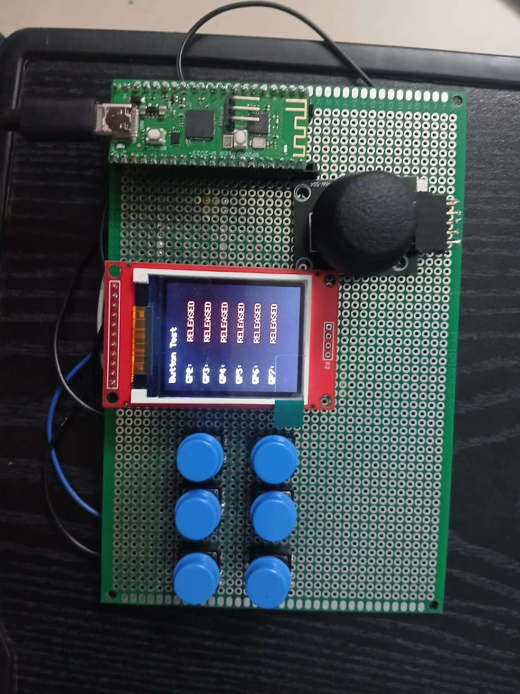
</p>

---

## What it does

The Smart Assistive Keyboard is a driver-free assistive typing device for users with limited fine motor control. The user scrolls through characters on a 1.8" TFT display using an analog joystick and confirms each selection with dedicated tactile push buttons. A Raspberry Pi Pico W reads the inputs, manages input layers, and sends standard USB HID keystrokes to a connected computer, typing directly into any application without host software, custom drivers, or an internet connection.

---

## Why

Approximately 96 million people in India have unmet assistive-technology needs, with affordability cited as the most common barrier at 36.9% (*Senjam et al., The Lancet Regional Health – Southeast Asia, 2023;15:100213*). Commercial eye-trackers and adaptive switch arrays often cost hundreds of dollars and depend on proprietary operating-system drivers. This project addresses the cost barrier by combining low-cost commodity components, open-source firmware, and a driverless USB HID interface into a self-contained typing tool.

---

## How it works

<p align="center">
  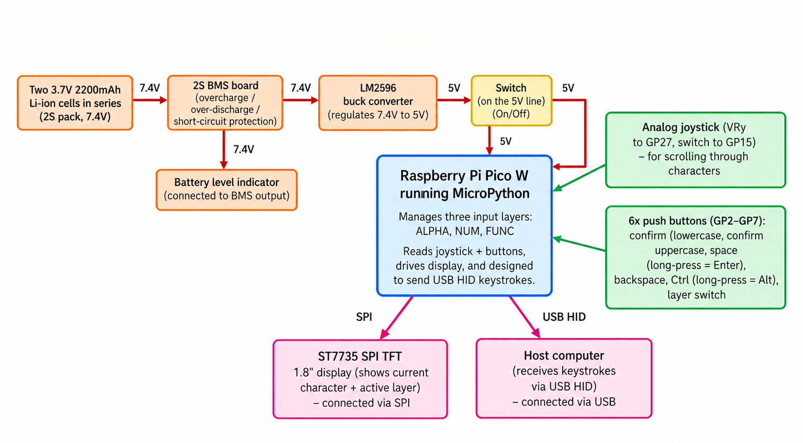
</p>

```text
[ Joystick (VRy) ] ──> Scroll Character Carousel
[ Tactile Buttons ] ──> Confirm / Backspace / Layer Switch
         │
         ▼
[ Raspberry Pi Pico W ] ──(SPI)──> [ ST7735 1.8" Display (Visual Feedback) ]
         │
         └──(USB Native HID)─────> [ Host PC (Driverless Keystrokes) ]
```

| Requirement | Implementation |
|---|---|
| **Driver-free host input** | Raspberry Pi Pico W native USB running standard USB HID keyboard reports via `adafruit_hid` |
| **Low motor-fatigue input** | Single-axis deflection on KY-023 analog joystick mapped to character carousel navigation |
| **Tremor & bounce rejection** | ±8000 ADC count dead-zone around calibrated joystick centre; 15 ms button debounce |
| **Real-time character display** | 128×160 SPI TFT (ST7735) displaying active character and layer status |
| **Regulated battery power** | 2S 18650 Li-ion pack (7.4 V) with 2S BMS, stepped down to 5.0 V via LM2596 buck converter into Pico VSYS |

---

## Features

- **Driverless USB HID Typing**: Enumerates as a standard USB keyboard on Windows, macOS, Linux, and Android.
- **Three Core Layers**: Instant toggling between `ALPHA` (A–Z), `NUM` (0–9), and `FUNC` (F1–F12).
- **Long-Press Key Multiplexing**: Space short-press / Enter long-press; Ctrl short-press / Alt long-press.
- **Joystick Dead-Zone Management**: Ignores hand tremors and centering drift within ±8000 ADC counts of centre.
- **Self-Contained Power Subsystem**: Onboard 2S battery and buck regulator provide a stable 5.0 V supply.

---

## Hardware

| Component | Specification | Quantity |
|---|---|:---:|
| **Microcontroller** | Raspberry Pi Pico W (RP2040 dual ARM Cortex-M0+, 133 MHz, 2 MB Flash) | 1 |
| **Display** | ST7735 1.8" SPI TFT LCD (128×160 RGB, 4-wire SPI, 3.3 V logic) | 1 |
| **Analog Joystick** | KY-023 2-axis potentiometer + push switch (VRy to ADC, SW to GP15) | 1 |
| **Tactile Buttons** | 6×6×5 mm momentary push buttons (Active-low, internal pull-ups) | 6 |
| **Battery Pack** | 18650 Li-ion cells (3.7 V, 2200 mAh each in 2S series = 7.4 V nominal) | 2 |
| **BMS** | 2S 7.4 V / 8.4 V lithium-ion protection board | 1 |
| **Buck Converter** | LM2596 step-down DC-DC switching regulator (7.4 V to 5.0 V output) | 1 |
| **Power Switch** | SPST toggle switch (inline with Pico VSYS) | 1 |
| **Substrate** | FR-4 double-sided perfboard with point-to-point soldered wiring | 1 |

---

## Wiring / pin map

| Pico W Pin | Label / GPIO | Connected Component | Function |
|---|---|---|---|
| **Pin 24** | GP18 | ST7735 SCK | SPI0 Serial Clock |
| **Pin 25** | GP19 | ST7735 MOSI | SPI0 Data Out |
| **Pin 26** | GP20 | ST7735 DC | Data / Command Select |
| **Pin 27** | GP21 | ST7735 RST | Display Reset |
| **Pin 22** | GP17 | ST7735 CS | SPI0 Chip Select |
| **Pin 36** | 3V3 | ST7735 VCC / LED+ | 3.3 V Power Rail |
| **Pin 38** | GND | ST7735 GND / LED- | Ground |
| **Pin 32** | GP27 (ADC1) | KY-023 VRy | Analog Y-Axis (Character Scroll) |
| **Pin 20** | GP15 | KY-023 SW | Joystick Push Switch |
| **Pin 36** | 3V3 | KY-023 VCC (3.3 V) | Analog Reference Rail (3.3 V) |
| **Pin 4** | GP2 | Button 1 (Select) | Character Confirm (Active-Low) |
| **Pin 5** | GP3 | Button 2 (Caps) | Case Toggle (Active-Low) |
| **Pin 6** | GP4 | Button 3 (Space / Enter) | Short: Space / Long (>600 ms): Enter |
| **Pin 7** | GP5 | Button 4 (Backspace) | Delete Character (Active-Low) |
| **Pin 9** | GP6 | Button 5 (Ctrl / Alt) | Short: Ctrl / Long (>600 ms): Alt |
| **Pin 10** | GP7 | Button 6 (Layer) | Cycle ALPHA → NUM → FUNC |
| **Pin 39** | VSYS | LM2596 OUT+ | 5.0 V Regulated Input (via toggle switch) |
| **Pin 38** | GND | LM2596 OUT- | Common System Ground |

---

## Prototype & field experience

### Hardware Prototype & Recognition

| Integrated Hardware Prototype | MICA 2026 1st Place Award |
|:---:|:---:|
| 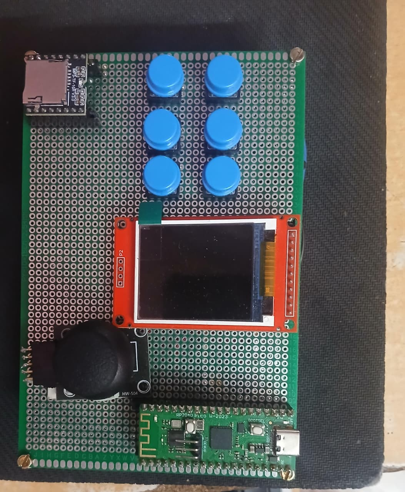<br>*Integrated perfboard prototype: Raspberry Pi Pico W, ST7735 TFT display, KY-023 joystick, and 6 tactile buttons.* | 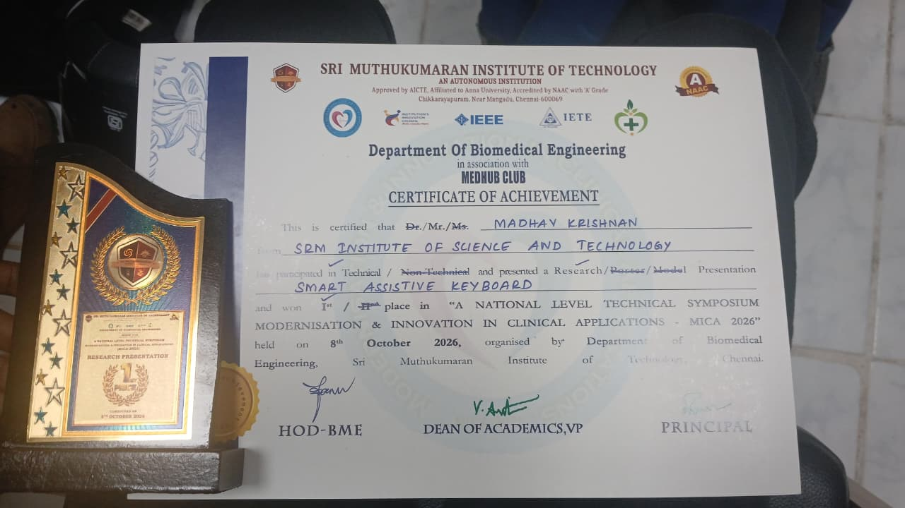<br>*First Place Certificate of Achievement, Research Paper Presentation at MICA 2026 symposium.* |

### User Testing & Field Demonstrations

The working prototype was demonstrated across two field sites: **Cheshire Homes India (Chennai)** and **Satyalok School**, engaging participants with motor difficulties under observation.

#### 1. Cheshire Homes Field Demonstration

| Setup & Overview | Joystick Character Navigation |
|:---:|:---:|
| 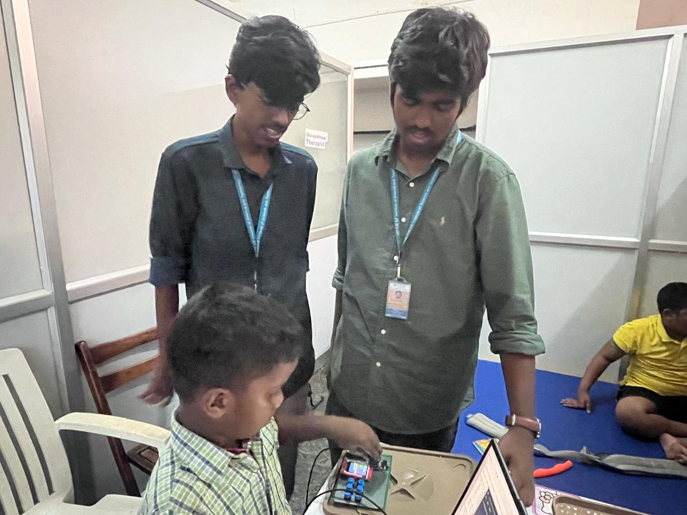<br>*Setup in occupational therapy unit: prototype connected via USB HID to laptop with team observation.* | 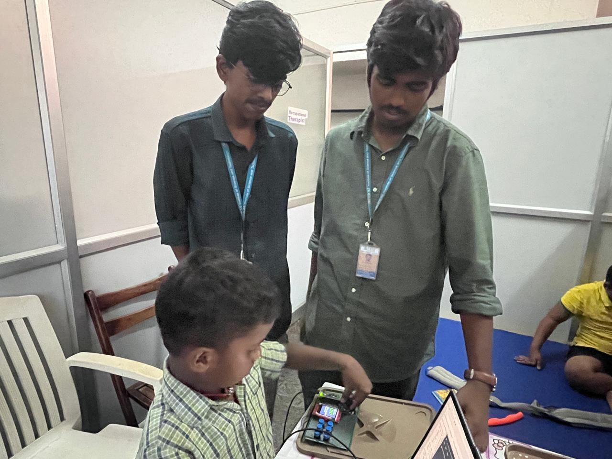<br>*Participant navigating the character carousel using single-axis analog joystick deflection.* |
| **Tactile Button Selection** | **Active Typing Session** |
| 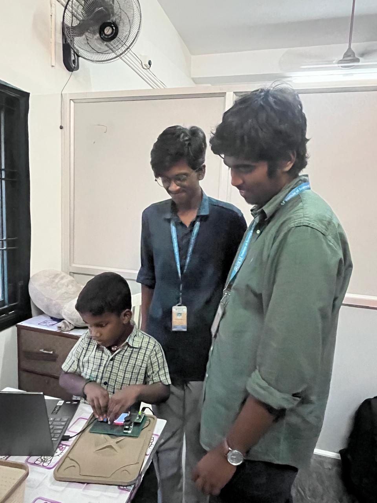<br>*Participant confirming character selection via momentary tactile push button.* | 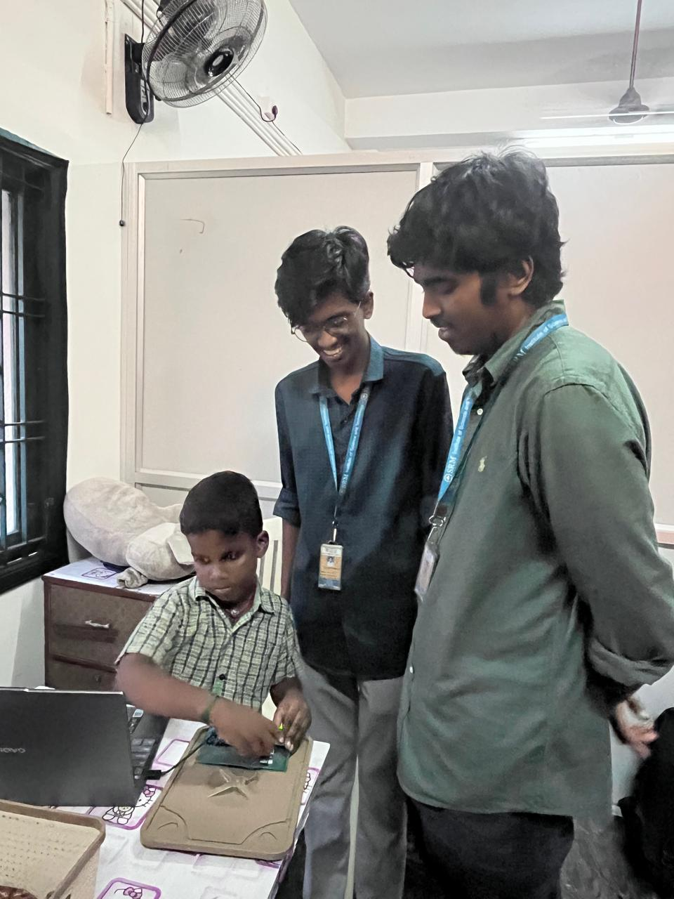<br>*Participant actively typing words and validating HID output on host computer.* |

#### 2. Satyalok School Field Demonstration

| Display & Connectivity Demonstration | Tactile Button Input |
|:---:|:---:|
| 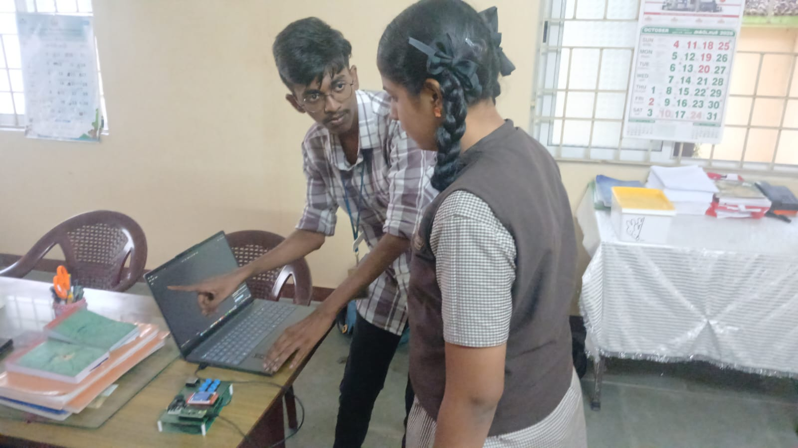<br>*Demonstrating character display feedback and driverless USB HID input to student.* | 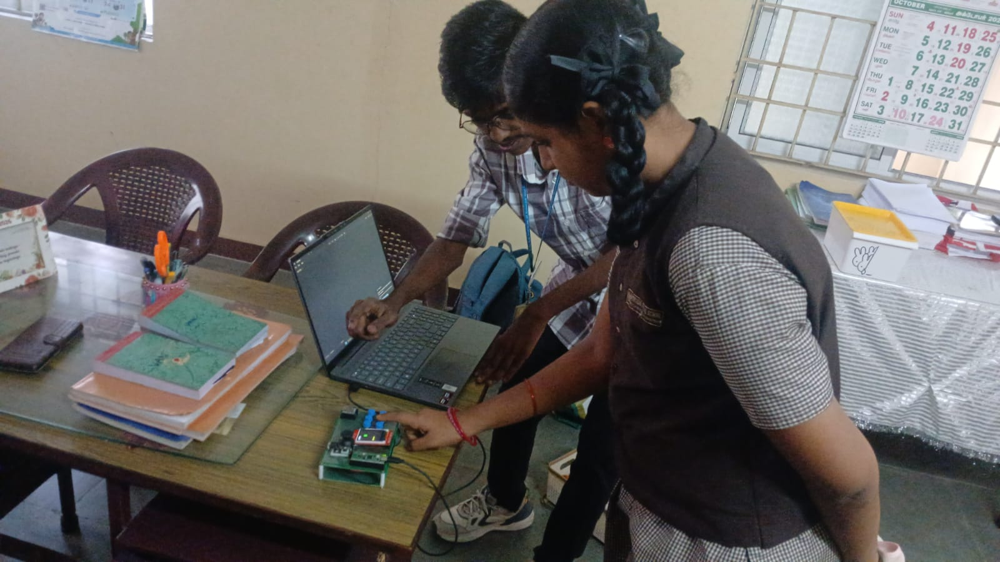<br>*Student confirming character input using tactile button cluster.* |
| **Joystick Character Navigation** | **Joystick Deflection & Ergonomics** |
| 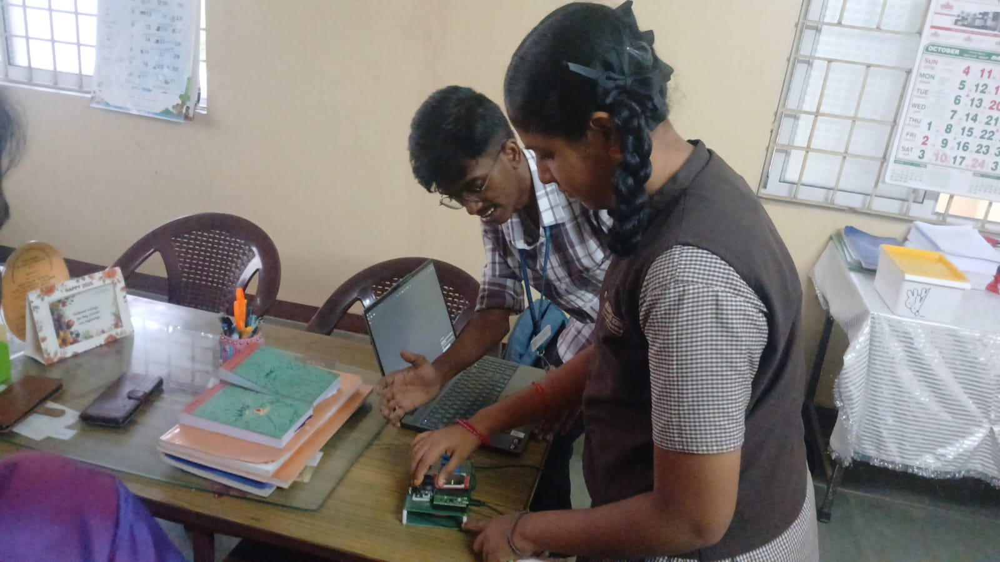<br>*Student navigating character options using analog joystick.* | 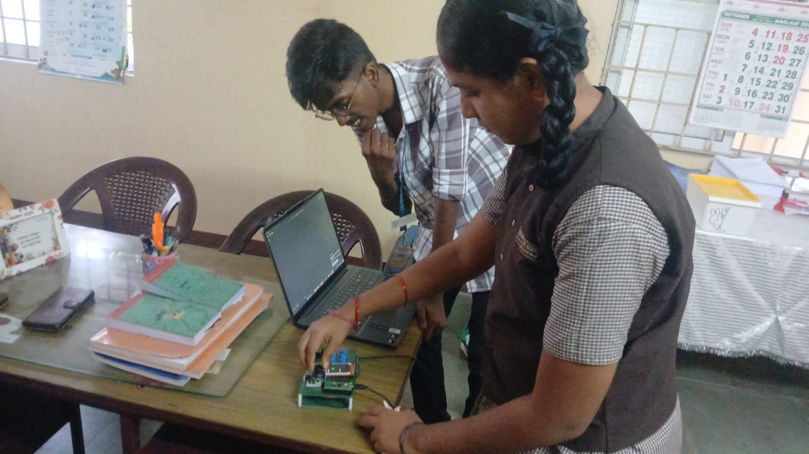<br>*Testing joystick dead-zone deflection, ergonomics, and spring-return centering.* |

<p align="center">
  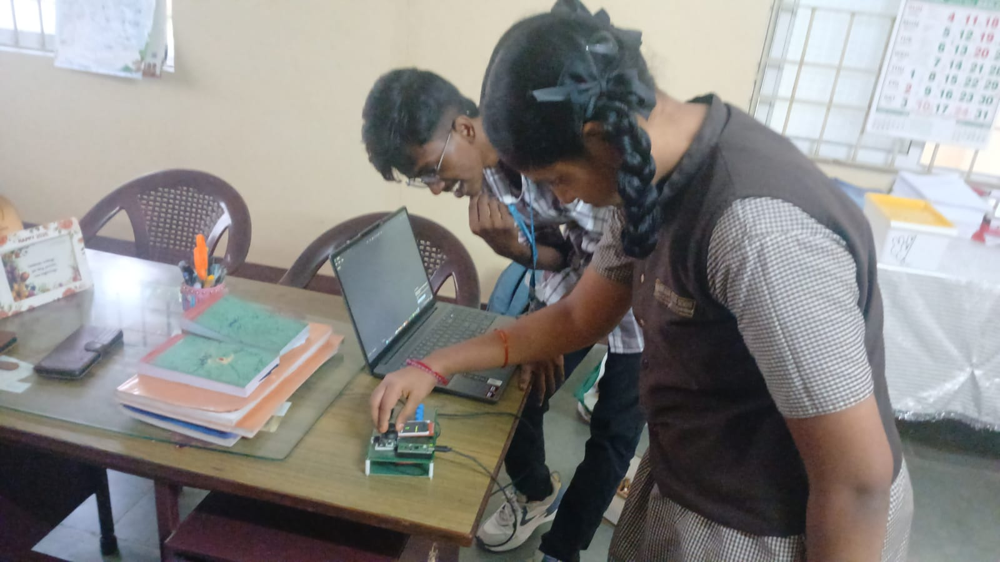<br>
  <em>Hands-on user testing session: student typing directly into host laptop via USB HID.</em>
</p>

### Demonstration Feedback
Qualitative feedback collected from therapy staff and observation during the field sessions:
- **Control Identification**: Push buttons require physical keycaps with distinct colors or textures to help users identify actions.
- **Portability & Charging**: Staff inquired about integrated battery charging and enclosure mounting options.
- **Audio Prompts**: A recommendation was made to include audio confirmation prompts to assist users whose gaze shifts away from the screen.

*Note: This interaction was a preliminary qualitative demonstration to gather feedback from therapy staff and participants, not a formal clinical trial or quantitative medical evaluation.*

---

## Firmware

The firmware runs on CircuitPython (`code.py`). It continuously samples the analog joystick, debounces physical switches, shifts layers, updates the ST7735 display, and dispatches keystrokes via USB HID.

```text
CIRCUITPY/
|-- code.py
+-- lib/
    |-- adafruit_st7735r.mpy
    |-- adafruit_display_text/
    |-- adafruit_hid/
    +-- adafruit_bus_device/
```

### Input Layers
- **`ALPHA`**: English alphabet (`A`–`Z`).
- **`NUM`**: Numeric digits (`0`–`9`).
- **`FUNC`**: Function keys (`F1`–`F12`).

### Thresholds & Multiplexing
- **Joystick Dead-Zone**: ±8000 ADC counts around the calibrated centre to prevent unintended scrolling.
- **Button Debounce**: 15 ms stable low state required to register a press.
- **Long-Press Actions (600 ms)**:
  - `GP4`: Press `< 600 ms` sends Space; press `≥ 600 ms` sends Enter.
  - `GP6`: Press `< 600 ms` sends Ctrl; press `≥ 600 ms` sends Alt.

### Flashing CircuitPython
1. Hold the **BOOTSEL** button on the Raspberry Pi Pico W while connecting it to a computer via USB.
2. Release the button when the `RPI-RP2` drive appears.
3. Download the official CircuitPython UF2 binary for the Raspberry Pi Pico W and copy it to the `RPI-RP2` drive.
4. Once rebooted, the drive will mount as `CIRCUITPY`.
5. Copy the following libraries from the [Adafruit CircuitPython Bundle](https://circuitpython.org/libraries) into `CIRCUITPY/lib/`:
   - `adafruit_st7735r.mpy`
   - `adafruit_display_text/`
   - `adafruit_hid/`
   - `adafruit_bus_device/`
6. Copy `firmware/code.py` to `CIRCUITPY/code.py`.

---

## Repository structure

```text
assistive-rotary-keyboard/
|-- firmware/
|   +-- code.py                    CircuitPython main loop and HID driver
|-- hardware/
|   |-- schematics/                Wiring references and circuit schematics
|   +-- 3d/                        (Planned) 3D enclosure CAD files
|-- docs/
|   +-- 3d/                        (Planned) Interactive 3D web viewer
|-- images/
|   |-- hero.jpg                   Device overview (active prototype)
|   |-- prototype.jpg              Perfboard component layout
|   |-- block-diagram.png          System power and signal block diagram
|   |-- certificate.jpg            MICA 2026 symposium certificate
|   +-- user_testing/              Field testing and demonstration photographs
|       |-- Cheshire_image_1(ok).jpeg
|       |-- Cheshire_image_2(joystick).jpeg
|       |-- Cheshire_buttons_3(ok).jpeg
|       |-- Cheshire_6(user).jpeg
|       |-- Satyalok_image_2(ok).jpeg
|       |-- Satyalok_image_4(buttonclick).jpeg
|       |-- Satyalok_image_5(joystick).jpeg
|       |-- Satyalok_image_7(joystick).jpeg
|       +-- Satyalok_image_10(usertest).jpeg
|-- LICENSE                        MIT License
+-- README.md                      Project documentation
```

---

## Status / Roadmap

### Completed & Validated
- [x] **USB HID Keystroke Output**: Tested and validated over USB on a laptop; transmits keystrokes from push buttons with no host drivers.
- [x] **Hardware Perfboard Integration**: Pico W, ST7735 display, KY-023 joystick, and 6 tactile buttons assembled and wired on a single board.
- [x] **Power Subsystem**: 2S Li-ion pack, BMS, and LM2596 buck converter supplying a verified 5.0 V to Pico VSYS.
- [x] **Switch Debounce & Long-Press Logic**: 15 ms debounce and 600 ms long-press handling operational in firmware.
- [x] **Qualitative Field Demonstration**: Working prototype demonstrated with therapy staff and two participants.

### In Active Development
- [ ] **Joystick Navigation**: Character scrolling on the display via analog deflection on VRy with a fixed repeat rate.
- [ ] **Input Layer Switching**: Dynamic cycling between `ALPHA`, `NUM`, and `FUNC` layers via dedicated button.
- [ ] **Display Buffer Optimization**: Improving ST7735 redraw speeds to eliminate visual flicker during continuous scrolling.
- [ ] **Joystick Centre Calibration**: Dynamic ADC baseline calibration at startup to prevent centering drift.

### Roadmap
- [ ] **3D Enclosure & Keycaps**: Design and 3D print an ergonomic chassis with high-contrast, labeled keycaps.
- [ ] **Interactive 3D Web Viewer**: Publish CAD turntable view (`docs/3d/` and `hardware/3d/model.glb`).
- [ ] **Audio Feedback**: Integrate a piezo buzzer or voice module for audible character confirmation.
- [ ] **Typing Performance Benchmarking**: Measure typing speed (WPM) and character error rates.

---

## 3D model

A custom ergonomic enclosure and keycap set are currently in development (see [Roadmap](#status--roadmap)). Once modeled, CAD assets will be hosted in `hardware/3d/model.glb` and viewable via the GitHub Pages viewer at:

👉 **[Interactive 3D Model Viewer (docs/3d/)](docs/3d/)** *(Planned)*

---

## Team

- **Aniruth B** — Firmware & system design
- **Madhavkrishnan K S** — Literature & testing
- **Vrithik R** — Hardware & power electronics
- **R.S Srihari**

**Guide**: Dr. Arthi Rengaraj  
Department of Electronics and Communication Engineering  
SRM Institute of Science and Technology, Ramapuram, Chennai  

---

## Acknowledgements

- **MICA 2026**: Department of Biomedical Engineering, Sri Muthukumaran Institute of Technology, Chennai, for awarding 1st Place in the Research Paper Presentation track.
- **Therapy Staff**: For their time and observations during the device demonstration.
- **Open-Source Hardware Community**: For foundational work on accessible, DIY Human Interface Devices.

---

## License

This project is licensed under the [MIT License](LICENSE).
