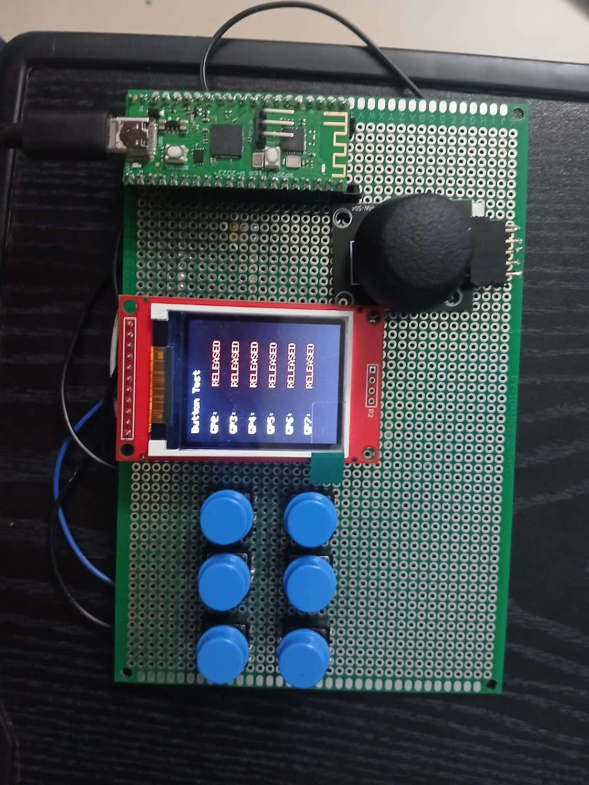
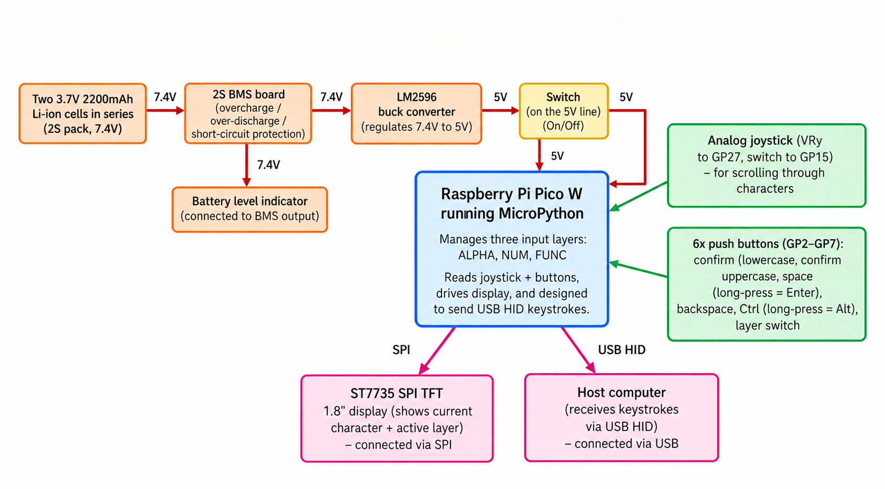
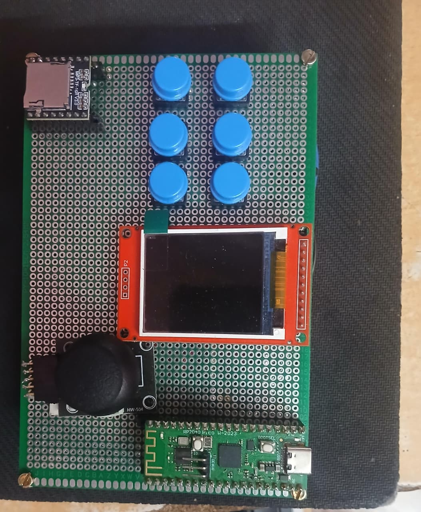

# Smart Assistive Keyboard — Repository Documentation Handoff

**Owner:** K.S. Madhavkrishnan (ksmadhavkrishnan@gmail.com)
**Repo:** `github.com/madhavkrishnanks/assistive-rotary-keyboard` (public, MIT)
**Prepared:** 6 November 2026

---

## 0. HOW TO USE THIS FILE

This file is a single, self-contained context pack for an AI coding agent (GitHub Copilot Chat, Copilot Workspace, Antigravity, Cursor, or any chat agent). It carries the project facts, the verified hardware map, the image pack, and the exact task.

**Two ways to use it:**

| Mode | What to do |
|---|---|
| **Whole-file paste (recommended)** | Paste this entire file into the agent, then also paste the **Task Prompt** from Part C. The agent reads Parts A–B as ground truth and Part C as the instruction. |
| **Prompt-only paste** | If the agent already has the repo open, paste only Part C. It refers back to the sections in this file, so paste those too, or keep this file in the repo as `docs/HANDOFF.md` and tell the agent to read it. |

**The one rule that matters:** the agent must not invent features, numbers, names, or dates. Every fact it needs is in this file. Anything marked `VERIFY` is something the owner must confirm before publishing.

---

## 1. FACT LEDGER — the single source of truth

Confidence key:
- **VERIFIED** — confirmed on hardware or measured in the Oct 2026 bench session.
- **REPORTED** — stated by the team in a status document, not independently confirmed.
- **VERIFY** — the source documents disagree; the owner must pick one before publishing.

| # | Item | Canonical value | Confidence |
|---|---|---|---|
| 1 | Project title | *Smart Assistive Keyboard: A Driverless HID Typing Interface for Motor-Impaired Users* | VERIFIED |
| 2 | Institution | SRM Institute of Science and Technology, Ramapuram Campus, Chennai — Dept. of Electronics and Communication Engineering | VERIFIED |
| 3 | Team size | **3 members** — Madhavkrishnan K S, Vrithik R, R.S Srihari | VERIFY (see §6) |
| 4 | Guide | Dr. Arthi Rengaraj, Associate Professor | VERIFIED |
| 5 | MCU | Raspberry Pi Pico W (RP2040, dual Cortex-M0+, 133 MHz, 2 MB flash, CYW43 Wi-Fi — unused) | VERIFIED |
| 6 | Firmware platform | **CircuitPython 10.3.1** on the board; an earlier MicroPython implementation is retained for reference | VERIFY (see §4) |
| 7 | Display pins | SCK GP10 · SDA GP11 · A0/DC GP16 · RESET GP17 · CS GP18 · LED(backlight) 3V3 | VERIFIED (see §3) |
| 8 | USB HID | Implemented via `adafruit_hid`; typed A, 1, Space, Backspace and layer changes on a laptop during bench testing | VERIFY (see §5) |
| 9 | Display rendering | Panel initialises without error but shows a **uniform white screen** — open hardware fault | VERIFIED |
| 10 | Joystick | Working; centre calibrates to ≈32748 ADC counts (healthy rest ≈32768) | VERIFIED |
| 11 | Power rail | 3.19–3.27 V at the display VCC under load; 5.0 V from the LM2596 into VSYS | VERIFIED |
| 12 | Field interaction | A **demonstration**, not a study. Two children with motor difficulties, at Cheshire Homes India – Chennai, 7 Oct 2026. Never call it testing, evaluation, or a trial. | VERIFIED |
| 13 | Award | 1st place, Research Paper Presentation, MICA 2026 (8 Oct 2026), Dept. of Biomedical Engineering, Sri Muthukumaran Institute of Technology, Chennai | VERIFIED |
| 14 | Accessibility figure | ≈96 million people in India have unmet assistive-technology needs; cost is the most common barrier at 36.9% (Senjam et al., *The Lancet Regional Health – Southeast Asia*, 2023;15:100213) | VERIFIED |
| 15 | Licence | MIT | VERIFIED |

**How the agent should handle a `VERIFY` row:** use the canonical value above (it is the best-supported reading), and leave an HTML comment next to it, e.g. `<!-- VERIFY: confirm firmware platform before publishing -->`. Never silently drop the item.

---

## 2. THE PROJECT

### 2.1 One-paragraph description (reuse this wording)

A low-cost, driver-free assistive keyboard for people with motor impairments or limited hand control. The user scrolls through characters with an analog joystick and confirms each selection with dedicated tactile push buttons; a Raspberry Pi Pico W turns each confirmed selection into a standard USB HID keystroke, so the device enumerates as an ordinary keyboard on any host — no drivers, no host software, no internet connection. Feedback is shown on a 1.8" ST7735 SPI TFT. Power comes from a 2S 18650 Li-ion pack through a 2S BMS and an LM2596 buck converter.

### 2.2 The problem it addresses

About 96 million people in India have unmet assistive-technology needs, and affordability is the most common barrier (36.9%). Commercial eye-trackers and adaptive switch arrays cost hundreds of dollars and depend on proprietary OS drivers. This project combines commodity parts, open firmware, and a driverless USB HID interface into a self-contained typing tool that a workshop can build and repair.

### 2.3 Signal path

```text
[ KY-023 joystick VRy ]──► character carousel scroll
[ 6 tactile buttons  ]──► confirm / caps / space / backspace / ctrl / layer
            │
            ▼
   [ Raspberry Pi Pico W ]──(SPI)──► [ ST7735 1.8" TFT — visual feedback ]
            │
            └──(native USB HID)────► [ Host PC — driverless keystrokes ]
```

### 2.4 Design decisions worth documenting

| Requirement | How it is met |
|---|---|
| Driver-free host input | Pico W native USB; standard HID keyboard reports via `adafruit_hid` |
| Low motor-fatigue input | Single-axis deflection (VRy) drives the character carousel |
| Tremor / bounce rejection | ±8000 ADC-count dead-zone around the calibrated centre; 15 ms button debounce |
| Real-time feedback | 128×160 ST7735 over 4-wire SPI |
| Regulated battery power | 2S pack (7.4 V) → 2S BMS → LM2596 at 5.0 V → VSYS |
| Affordability | Commodity modules, perfboard, no custom PCB required |

---

## 3. HARDWARE — canonical pin map

> **This section overrides every other pin table.** Older drafts used GP18/GP19/GP20/GP21 for the display; that is wrong for this board and is why the screen stayed dark. Use exactly the table below.

### 3.1 Bill of materials

| Component | Specification | Qty |
|---|---|:--:|
| Microcontroller | Raspberry Pi Pico W (RP2040, 133 MHz, 2 MB flash) | 1 |
| Display | ST7735 1.8" SPI TFT, 128×160, red "128*160 V1.1" module, 3.3 V logic | 1 |
| Joystick | KY-023 analog 2-axis + push switch | 1 |
| Push buttons | 6 mm tactile momentary, active-low, internal pull-ups | 6 |
| Cells | 18650 Li-ion, 3.7 V, 2200 mAh | 2 |
| Protection | 2S BMS board (overcharge / over-discharge / short circuit) | 1 |
| Regulator | LM2596 step-down, set to 5.0 V | 1 |
| Switch | SPST toggle, in series with the 5 V line | 1 |
| Substrate | FR-4 double-sided perfboard, point-to-point soldered | 1 |

### 3.2 Display (ST7735) — actual module silkscreen, left to right

`LED · SCK · SDA · A0 · RESET · CS · GND · VCC` — there are **no NC pins** on this module. **A0 is Data/Command (DC), not an address line. LED is the backlight enable and must be connected.**

| Module pin | Meaning | Pico W pin | GPIO |
|---|---|---|---|
| VCC | 3.3 V logic power | Pin 36 | 3V3(OUT) |
| GND | Ground | Pin 38 | GND |
| SCK | SPI clock | Pin 14 | **GP10** |
| SDA | SPI data (MOSI) | Pin 15 | **GP11** |
| A0 | Data / Command (DC) | Pin 21 | **GP16** |
| RESET | Reset | Pin 22 | **GP17** |
| CS | Chip select | Pin 24 | **GP18** |
| LED | Backlight enable | Pin 36 | 3V3(OUT) |

Keep VCC at **3.3 V** on this module variant. Do not feed it 5 V.

### 3.3 Joystick (KY-023)

| Joystick pin | Pico W pin | GPIO | Note |
|---|---|---|---|
| VRy | Pin 32 | **GP27** (ADC1) | character scroll axis |
| SW | Pin 20 | **GP15** | joystick push switch |
| VRx | — | not connected | may be wired to GP26 — verify |
| VCC | Pin 36 | 3V3(OUT) | 3.3 V analog reference |
| GND | Pin 38 | GND | common ground |

### 3.4 Push buttons (other leg to GND, internal pull-ups)

| Button | Pico W pin | GPIO | Function |
|---|---|---|---|
| Select / Confirm | Pin 4 | GP2 | confirm the highlighted character |
| CAPS / SHIFT | Pin 5 | GP3 | case toggle |
| Space / Enter | Pin 6 | GP4 | short = Space, long (≥600 ms) = Enter |
| Backspace | Pin 7 | GP5 | delete |
| Ctrl / Alt | Pin 9 | GP6 | short = Ctrl, long (≥600 ms) = Alt |
| Layer | Pin 10 | GP7 | cycle ALPHA → NUM → FUNC → … |

### 3.5 Power chain

```text
2× 18650 (2S, 7.4 V) → 2S BMS → LM2596 buck (5.0 V out) → SPST switch → Pico VSYS
                              └──► battery level indicator (on BMS output)
```

On the bench the board is powered over USB (VBUS is the 5 V source). USB-C charging and an integrated charge port are **roadmap items, not built**.

### 3.6 Input layers

- **ALPHA** — A–Z
- **NUM** — 0–9
- **FUNC** — F1–F12
- **SYM** and **NAV** — present in the newer firmware build (symbols and navigation/cursor keys)

---

## 4. FIRMWARE

### 4.1 What runs on the board

The board runs **CircuitPython 10.3.1**. Libraries present in `/lib`:

```text
CIRCUITPY/
├── code.py
└── lib/
    ├── adafruit_st7735r.mpy
    ├── adafruit_bus_device/
    ├── adafruit_display_text/
    └── adafruit_hid/
```

> **VERIFY before publishing:** one status document (6 Nov 2026) still says "MicroPython". The Oct 2026 bench session concluded CircuitPython — the board shows the `adafruit_*` libraries and MicroPython-only modules (`machine`, `ST7735`, `sysfont`) are absent. Document CircuitPython as the current platform and describe MicroPython as the earlier implementation.

### 4.2 Two implementations, kept straight

| | MicroPython (legacy) | CircuitPython (current) |
|---|---|---|
| Display driver | `ST7735` + `sysfont` community modules | `adafruit_st7735r` + `displayio` |
| HID | `send_key()` was a **print-only placeholder** | real USB HID via `adafruit_hid` |
| Display pins in code | GP10 / GP11 / GP16 / GP17 / GP18 | must also be GP10 / GP11 / GP16 / GP17 / GP18 |
| Status | cannot run on the current board (modules absent) | the build to document |

An earlier CircuitPython draft used GP18/GP19/GP20/GP21 for the display — that pin set is wrong for this board and must not appear anywhere in the docs.

### 4.3 Tuned parameters (document these; they are real)

| Parameter | Value |
|---|---|
| Joystick dead-zone | ±8000 ADC counts around the calibrated centre |
| Button debounce | 15 ms stable state |
| Long-press threshold | 600 ms |
| HID tap delay | 10 ms |
| Scroll repeat interval | 300 ms |

### 4.4 Board quirks worth a wiki page

- The `CIRCUITPY` drive mounts as `OFF (F:)` on this Windows machine.
- **Only `code.py` auto-runs.** The firmware was renamed `off.py` on the board during testing; saving a file as `code.py` is what makes the keyboard work.
- `GP10 in use` errors: any script that creates the SPI bus on GP10 holds the pin until reset. Fix with Ctrl-D; if that fails, unplug USB and replug.
- `[CYW43] Failed to start CYW43` spam is the Pico W Wi-Fi chip failing to initialise. The project does not use Wi-Fi — ignore it.
- Windows hides file extensions; check filenames on the drive.

---

## 5. HONEST STATUS — what works, what does not

This table is the honesty contract for the whole repo. Do not upgrade a row without hardware evidence.

| Item | Status | Evidence |
|---|---|---|
| USB HID enumeration + keystrokes | **Working** | typed A, 1, Space, Backspace and layer changes on a laptop |
| Push-button input + debounce | **Working** | 15 ms debounce verified in firmware |
| Long-press multiplexing (Space/Enter, Ctrl/Alt) | **Working** | verified on the laptop |
| Layer switching | **Working** | ALPHA → NUM → FUNC confirmed |
| Joystick ADC + calibration | **Working** | centre ≈32748 counts, changes in all directions |
| Power subsystem | **Working** | 5.0 V into VSYS; display VCC holds 3.19–3.27 V under load |
| Perfboard integration | **Working** | Pico W, TFT, joystick, 6 buttons on one board |
| **Display rendering** | **OPEN FAULT** | panel initialises with no error but shows a uniform white screen |
| Joystick-driven scrolling on the display | **Not demonstrated** | depends on the display fault |
| Typing speed / accuracy (WPM, error rate) | **Not measured** | no benchmark has been run |
| Audio / voice feedback | **Planned only** | DFPlayer Mini not built |
| 3D enclosure, keycaps | **Planned only** | no CAD files yet |
| Integrated USB-C charging | **Planned only** | bench power is USB or the 2S pack |

### 5.1 The open display fault — how to describe it

Say: *"The display is a known open hardware fault. The panel is powered, backlit and the driver initialises without error, but it shows a uniform white screen — the controller is not accepting the init sequence or the pixel data. Continuity on all five signal lines measures 2–3 Ω, the Pico side toggles every line 0 ↔ 3.3 V, and VCC holds 3.2 V under load. The remaining suspects are a controller-variant mismatch (ST7735S vs ST7735R init) or a faulty module."*

Do **not** say the display works. Do **not** suggest `bgr`/`invert` fixes — those change colours or offset, never a uniform white.

### 5.2 How to describe HID

Default wording: *"USB HID is implemented and was verified to type on a laptop during bench testing (A, 1, Space, Backspace, layer changes). Typing speed and error rate have not yet been measured."*

If the owner confirms HID is not yet working end-to-end, downgrade to: *"USB HID is implemented in firmware and is the final integration step; end-to-end typing is in progress."* Pick one line and use it everywhere — README, wiki, deck, report.

---

## 6. PEOPLE AND CREDITS

| Role | Name | Reg. no. |
|---|---|---|
| Team | Madhavkrishnan K S | RA2411004020113 |
| Team | Vrithik R | RA2411004020118 |
| Team | R.S Srihari | RA2411004020123 |
| Guide | Dr. Arthi Rengaraj, Associate Professor | — |

> **VERIFY — team size.** The 6 Nov 2026 status sheet says the team is three people and that *Aniruth B is not on the team*. Two older drafts list a fourth member, Aniruth B (RA2411004020078), and the README currently live on GitHub lists him with the role "Firmware & system design". **The owner must decide.** If Aniruth contributed, credit him in Acknowledgements rather than as a team member. Do not delete a contributor's credit on your own — flag it and ask.

Naming rules for documents and certificates: name-first order — "MADHAVKRISHNAN K S", "VRITHIK R", "R.S SRIHARI".

### 6.1 Roles to state (adjust if the owner corrects)

- **Madhavkrishnan K S** — literature, system architecture, firmware, documentation
- **Vrithik R** — hardware and power electronics
- **R.S Srihari** — integration and testing
- **Dr. Arthi Rengaraj** — project guide

### 6.2 People who must not be named without consent

| Person | Role | Rule |
|---|---|---|
| Hariniya Priya | Occupational therapist, M.O.T. (Mental Health), SRM — met at Cheshire Homes | **Consent pending.** Until she agrees, write *"an occupational therapist at Cheshire Homes India – Chennai"*. Never call her a rehab doctor — that is a physiatrist, a different profession. |
| Children at Cheshire Homes | Demonstration participants | Never named, never photographed identifiably in a public repo without guardian consent. |

---

## 7. EVENTS, FIELD WORK, REFERENCES

### 7.1 Events

| Event | Detail |
|---|---|
| **MICA 2026** — 8 Oct 2026 | National symposium, Dept. of Biomedical Engineering, Sri Muthukumaran Institute of Technology, Chennai. **1st place, Research Paper Presentation.** |
| **Cheshire Homes India – Chennai** — 7 Oct 2026 | Field demonstration, 23A Third Seaward Road, Valmiki Nagar, Thiruvanmiyur, Chennai 600041. Two children with motor difficulties; qualitative feedback from an occupational therapist and a caretaker. |
| **NICEDT-2027** — 8–9 Jan 2027 | 5th NIELIT International Conference, NIELIT Calicut, offline, published with Springer. Track 7: Assistive Technology for Divyangjan. Full paper required. Status: decision pending. |

### 7.2 Feedback recorded during the demonstration

- Push buttons need distinct colour or texture per function so users can identify them by touch.
- Staff asked about integrated charging and an enclosure for mounting.
- Audio confirmation prompts were suggested, for users whose gaze leaves the screen.

### 7.3 References

1. Senjam SS, Manna S, Kishore J, et al. *The Lancet Regional Health – Southeast Asia*, vol. 15, 100213, 2023. https://doi.org/10.1016/j.lansea.2023.100213
2. MorseKey — https://github.com/jlubin2001/MorseKey
3. Chahor Rotary Keyboard — https://github.com/clackups/chahor_rotary_keyboard
4. Adafruit TRRS Trinkey — https://learn.adafruit.com
5. Adafruit CircuitPython ST7735R driver — https://github.com/adafruit/Adafruit_CircuitPython_ST7735R

---

## 8. IMAGE PACK — what goes where

All images are in `assistive-keyboard-repo-assets.zip`, already renamed, resized and compressed. Unzip it at the repo root and the `images/` folder lands in the right place. The agent does this itself — see the runbook in §10.1.

### 8.1 Inventory and placement

| File (repo path) | What it shows | Where it is used | Suggested caption |
|---|---|---|---|
| `images/hero.jpg` | The integrated perfboard prototype, top-down: Pico W, TFT, joystick, six buttons | README top banner | *Smart Assistive Keyboard — integrated perfboard prototype* |
| `images/prototype.jpg` | Close crop of the button cluster, TFT and joystick | README "Prototype" gallery | *Button cluster, ST7735 TFT and KY-023 joystick on the perfboard* |
| `images/block-diagram.png` | Power + signal block diagram: 2S pack → BMS → LM2596 → switch → Pico W → TFT / host | README "How it works"; wiki `01-Hardware-and-Wiring` | *System block diagram — power chain and signal path* |
| `images/field-demo-hands.jpg` | Hands operating the device next to a laptop, **no identifiable face** | README "Demonstration" — **the only field photo safe to publish now** | *Hands-on demonstration of the prototype during the field visit* |
| `images/field-demo-1.jpg` | A child operating the device while the team observes | `05-Field-Demonstration` wiki page — **consent-gated** | *Demonstration at Cheshire Homes India – Chennai* |
| `images/field-demo-2.jpg` | Wider room view of the demonstration (an "Occupational Therapist" door sign is visible) | `05-Field-Demonstration` wiki page — **consent-gated** | *Demonstration session at the occupational therapy unit* |
| `images/ot-session-1.jpg` | Occupational therapist and team member at the laptop with the device | `05-Field-Demonstration` wiki page — **consent-gated** | *Occupational therapist trying the keyboard during the field visit* |
| `images/ot-session-2.jpg` | The therapist operating the device beside a laptop | README gallery or wiki — **consent-gated** | *Operating the keyboard during the field visit* |

### 8.2 Consent gate — read this before publishing

`field-demo-1.jpg`, `field-demo-2.jpg`, `ot-session-1.jpg` and `ot-session-2.jpg` show identifiable people, including a **minor**. Publishing them in a public repository needs:

- written permission from the child's parent or guardian, and
- the occupational therapist's consent (already pending).

**Until both are in hand, publish only `hero.jpg`, `prototype.jpg`, `block-diagram.png` and `field-demo-hands.jpg`.** The agent must not commit the four gated photos to the public repo. Keep them in a private folder or add them after consent.

### 8.3 Assets that are missing — do not fake them

| Referenced in the current README | Status |
|---|---|
| `images/certificate.jpg` (MICA 2026 certificate) | **Not supplied.** The owner must scan or photograph it. Until then the agent must remove the reference — a broken image looks worse than a missing one. |
| `images/turntable.gif` (3D enclosure preview) | **Not supplied** and the enclosure does not exist yet. Remove it and leave the 3D section as roadmap only. |

### 8.4 Ready-to-paste Markdown

Hero, top of README (note the width — the image is portrait, so 85% renders enormous):

```html
<p align="center">
  
</p>
```

Block diagram, in the "How it works" section:

```html
<p align="center">
  
</p>
```

Two-up gallery, in a "Prototype and demonstration" section:

```html
| Prototype | Demonstration |
|:--:|:--:|
| <br>*Button cluster, TFT and joystick on the perfboard* | <br>*Hands-on demonstration during the field visit* |
```

### 8.5 Image hygiene rules for the agent

- Keep every path relative (`images/…`) and lower-case with hyphens. No spaces, no `WhatsApp Image…` names.
- Every `` gets a real `alt` attribute — this is an accessibility project; missing alt text is a bad look.
- Do not re-encode, crop or retouch the supplied images; they are already sized for the web (all under 220 KB except the diagram).
- Do not add stock photos, AI-generated renders, or diagrams you invent. If an image is missing, say so in the text.

---

## 9. CORRECTIONS THE AGENT MUST MAKE TO THE LIVE README

The README currently on `main` is close, but it carries six errors. Fix them in this order.

| # | Problem in the live README | Correct value |
|---|---|---|
| 1 | Display pin map says SCK **GP18**, MOSI **GP19**, DC **GP20**, RST **GP21**, CS **GP17** | SCK **GP10**, SDA/MOSI **GP11**, A0/DC **GP16**, RESET **GP17**, CS **GP18**. The old set is the wrong build and is a likely cause of the blank display. |
| 2 | Display pin names given as `LED+ / LED- / DC` | The module silkscreen reads **LED, SCK, SDA, A0, RESET, CS, GND, VCC**. A0 is DC. LED is the backlight enable and must be tied to 3.3 V. |
| 3 | `images/` folder does not exist in the repo, so hero, prototype, clinical-1, clinical-2 and certificate are all broken | Add the image pack (§8). Drop `certificate.jpg` and `turntable.gif` references until the files exist. |
| 4 | Photo names `clinical-1.jpg` / `clinical-2.jpg` | Rename to `field-demo-*.jpg`. "Clinical" implies a clinical study; this was a demonstration. |
| 5 | Team table lists four members including Aniruth B | Three members, per the 6 Nov 2026 status. **Confirm with the owner** before changing; if he contributed, move him to Acknowledgements. |
| 6 | Status list says joystick navigation and layer switching are "in active development" while the same README claims HID is validated | Replace the status section with §5 of this file. The joystick is fixed; the display is the open item. |

Two smaller fixes:

- The hero image is portrait — render it at `width="42%"`, not `85%`.
- "Three Core Layers" should mention the SYM and NAV layers that exist in the newer firmware, or say "core layers" and list all five with a note.

---

## 10. THE TASK — runbook and prompt

### 10.1 Antigravity runbook — do this first

Antigravity has terminal and file access, so it creates `images/`, copies the files in, commits and pushes without you touching GitHub's upload dialog. Set it up like this:

1. **Clone the repo and open the repo folder as the workspace** — not your Downloads folder, not a parent directory:

   ```bash
   git clone https://github.com/madhavkrishnanks/assistive-rotary-keyboard.git
   cd assistive-rotary-keyboard
   ```

2. **Drop two files into that folder**: `assistive-keyboard-repo-assets.zip` and this handoff file. Both are temporary — the agent deletes them at the end.

3. **Check your git credentials before you start**, because the agent has to push:

   ```bash
   gh auth status          # should show you logged in with repo scope
   git remote -v           # must be https://github.com/..., not git@github.com:
   ```

   If `gh` is not logged in, run `gh auth login` and pick HTTPS. If the remote is SSH, fix it: `git remote set-url origin https://github.com/madhavkrishnanks/assistive-rotary-keyboard.git`.

4. **Paste §10.2 into the agent.** Approve the `unzip`, `mkdir`, `git` and `gh` commands when it asks. Do not retype them yourself — the whole point is that it runs them.

5. **Check the result in three commands** when it stops:

   ```bash
   git ls-files images/            # exactly four files, no consent-gated ones
   git log --oneline -5            # four docs commits on docs/readme-and-wiki
   gh pr view --web                # the PR opens; the hero image must render
   ```

6. **Enable the wiki once, by hand.** GitHub does not create a wiki repo until the first page exists: go to the repo → **Wiki** → *Create the first page* → save anything → then the agent can push all nine pages to `assistive-rotary-keyboard.wiki.git` (it is told how in §10.2).

If you would rather not let the agent push, tell it to stop after the commit and you push the branch yourself. Everything else works the same.

### 10.2 The prompt — paste this into the agent

Everything between the fences is the instruction. It assumes the agent is running in the cloned repo with this file open.

```text
ROLE
You are a senior technical writer and embedded-systems engineer maintaining the
public GitHub repository for "Smart Assistive Keyboard: A Driverless HID Typing
Interface for Motor-Impaired Users" (Raspberry Pi Pico W, CircuitPython, USB HID,
1.8" ST7735 TFT, 2S Li-ion power). The repo is at
github.com/madhavkrishnanks/assistive-rotary-keyboard (public, MIT licence).
The owner is a B.Tech ECE student; the repo is read by recruiters, judges,
reviewers and other makers who want to rebuild the device.

INPUTS
- This handoff file: authoritative for every fact, pin, threshold and status.
- assistive-keyboard-repo-assets.zip, in the repo root: the image pack. It
  contains images/ (8 files), docs/HANDOFF.md and README-FIRST.txt.

YOU HAVE A TERMINAL AND FILESYSTEM ACCESS. Use them. Do not ask the owner to
create folders, upload files, drag anything into a browser, or copy-paste
commands. If a step needs a shell command, run it yourself and report the
output. The only thing you must ask the owner about is a genuine ambiguity
(team size, HID status) or a consent decision.

YOUR JOB — four deliverables, in this order.

1) images/ — create the folder and put the files in it yourself, then commit
   them. Run exactly this, in the repo root:

     unzip -o assistive-keyboard-repo-assets.zip -d .
     mkdir -p images/consent-pending
     mv images/field-demo-1.jpg images/field-demo-2.jpg \
        images/ot-session-1.jpg images/ot-session-2.jpg images/consent-pending/
     printf 'images/consent-pending/\n' >> .gitignore
     rm -f README-FIRST.txt
     ls -la images/

   Then confirm with `git ls-files images/` that exactly four files are tracked:
   hero.jpg, prototype.jpg, block-diagram.png, field-demo-hands.jpg.

   The four files you moved to images/consent-pending/ show identifiable people,
   including a minor, and must never be committed or published. They stay on the
   owner's disk for the day consent arrives. If .gitignore already lists them,
   do not duplicate the line.

   Then grep the repo for image references and fix them: every  and
   ![...] must resolve to a tracked file. Delete the references to
   certificate.jpg and turntable.gif — those files do not exist and must not be
   invented.

   Commit this step alone, before writing any prose:

     git checkout -b docs/readme-and-wiki
     git add images/ .gitignore
     git commit -m "docs: add image pack and ignore consent-gated photos"

2) README.md — rewrite it to the section order below. Keep it under 350 lines of
   prose; this is a front page, not the manual. Depth belongs in the wiki.

   1.  Title + one-line description + badge row (licence, platform, language,
       status, award). Keep the existing badges; correct the language badge to
       CircuitPython.
   2.  Hero image (images/hero.jpg, width 42%).
   3.  "What it does" — 4-6 sentences, plain language, no marketing adjectives.
   4.  "Why it matters" — the 96 million / 36.9% figure with the citation, and one
       sentence on what commercial alternatives cost.
   5.  "How it works" — the block diagram image, the ASCII signal path, and the
       design-decision table from the handoff.
   6.  "Features" — six bullets, each a capability that is actually implemented.
   7.  "Hardware" — BOM table with quantities, then the power-chain diagram.
   8.  "Wiring" — the canonical pin tables: display, joystick, buttons. Use the
       exact GPIOs from the handoff. This is the most-read section in the repo;
       make it copy-paste-usable.
   9.  "Firmware" — CircuitPython, library list, the tuned-parameter table, and a
       short flashing procedure (BOOTSEL, UF2, copy libs, copy code.py).
   10. "Prototype and demonstration" — the two-up gallery and the feedback bullets,
       followed by the one-line disclaimer that this was a demonstration, not a
       study.
   11. "Status" — the honest table from the handoff, with the display fault
       described in the same careful language.
   12. "Repository structure" — a tree that matches the real repo.
   13. "Roadmap" — planned items only: enclosure and keycaps, audio feedback,
       USB-C charging, typing benchmarks, controller-variant investigation.
   14. "Build it yourself" — a short bill of materials to buy plus the order of
       assembly, in five steps.
   15. "Team and acknowledgements" — names, roles, guide, institution, MICA 2026.
   16. "References", "Licence", and a footer linking to the wiki pages.

3) docs/wiki/ — write the wiki as plain Markdown files, then publish it to the
   GitHub wiki yourself. One file per page, exact filenames:
   Home.md, _Sidebar.md, _Footer.md, 01-Hardware-and-Wiring.md,
   02-Firmware-and-Keymap.md, 03-Build-and-Flashing-Guide.md,
   04-Troubleshooting.md, 05-Field-Demonstration.md, 06-Roadmap-and-Open-Issues.md,
   07-FAQ.md

   Content brief for each page is in section 11 of the handoff. Each page opens
   with a one-sentence summary, uses H2 sections, keeps tables for pin maps and
   parameters, and ends with "Next: [page]" navigation. _Sidebar.md lists all
   pages in order.

   Image paths: the wiki is a separate git repository, so `images/...` does NOT
   resolve there from the main repo. Do this instead:

     # 1. commit the wiki sources into the main repo (so they live with the code)
     git add docs/wiki && git commit -m "docs: add wiki pages"
     git push -u origin docs/readme-and-wiki

     # 2. copy the four public images into the wiki repo as well
     git clone https://github.com/madhavkrishnanks/assistive-rotary-keyboard.wiki.git ../wiki
     cp docs/wiki/*.md ../wiki/
     mkdir -p ../wiki/images
     cp images/hero.jpg images/prototype.jpg images/block-diagram.png \
        images/field-demo-hands.jpg ../wiki/images/
     cd ../wiki && git add -A && git commit -m "docs: add project wiki"
     git push origin master      # use 'main' if the wiki repo says so

   If the wiki clone fails with "repository not found", the owner has not created
   the first wiki page yet. Do not fake it: leave the pages committed under
   docs/wiki/, tell the owner in one line to open the repo's Wiki tab and click
   "Create the first page", then re-run step 2.

   Every wiki page must reference only the four public images. Never link, embed
   or mention the consent-gated photos in a committed file — if a page needs to
   acknowledge them, use an HTML comment: <!-- consent-gated photos held locally -->

4) docs/HANDOFF.md — copy this handoff file into the repo and commit it, so
   future contributors and agents inherit the same ground truth. Then delete the
   zip and the stray README-FIRST.txt from the working tree:

     cp <path to this handoff file> docs/HANDOFF.md
     git add docs/HANDOFF.md
     git commit -m "docs: add project handoff"
     rm -f assistive-keyboard-repo-assets.zip README-FIRST.txt

   Confirm the zip is not tracked: `git ls-files | grep -i zip` must print nothing.

STYLE RULES
- British-neutral technical English, present tense, active voice. No hype words
  ("revolutionary", "cutting-edge", "seamless", "empowering").
- Sentence case for headings. No emoji in the README. No decorative banners made
  of unicode characters.
- Second person for instructions ("connect the display's LED pin to 3V3").
- Every table gets a header row and aligned columns. Every code fence gets a
  language tag (python, text, bash).
- Numbers: SI units, °C, millimetres; write "3.3 V", "15 ms", "±8000 ADC counts".
- State units and tolerances. "5.0 V" not "5V" in prose; "GP10" not "pin 14" alone
  — give both in pin tables.

ACCURACY GUARDRAILS — these are hard rules
- Never claim a feature works unless the handoff marks it as working. The display
  does not work. Say so, in the careful wording provided.
- Never invent a benchmark, a WPM figure, a user count, a date, a person's name,
  a citation or a spec. If a number is not in the handoff, leave it out.
- Never describe the field interaction as testing, a trial, an evaluation or a
  study. It was a demonstration. Never say anyone was diagnosed.
- Never call the occupational therapist a rehab doctor, and do not name her.
- Keep the display pins exactly as given: GP10, GP11, GP16, GP17, GP18. If you
  find the old GP18/19/20/21 set anywhere, fix it and mention the fix in the
  commit message.
- Keep every claim about the platform as CircuitPython; the MicroPython code is
  legacy reference only and cannot run on the current board.
- Mark anything you could not confirm with an HTML comment:
  <!-- VERIFY: ... -->. Do not delete an unverified item silently.
- Do not touch LICENSE, and do not add a licence header to files.
- Do not rewrite or delete the existing demo video
  (Assistive_Rotary_Keyboard_video.mp4) or photo (Assistive_Rotary_Keyboard_pic.jpeg)
  at the repo root; reference them from the README if useful.

WORKING METHOD
- Work on a branch called docs/readme-and-wiki. One commit per deliverable:
  "docs: add image pack and ignore consent-gated photos", "docs: rewrite README",
  "docs: add wiki pages", "docs: add project handoff". Run the git commands
  yourself; do not hand them to the owner.
- Do not push to main. Push the branch and open a pull request with `gh pr create`
  (or `gh pr create --fill`), with a description that lists the six corrections
  from section 9 of the handoff and the two open questions for the owner (team
  size, HID status).
- Before you finish, run this self-check and paste the real command output in the
  PR — not a ticked box you did not verify:
    [ ] `git ls-files images/` lists exactly hero.jpg, prototype.jpg,
        block-diagram.png, field-demo-hands.jpg
    [ ] `git ls-files | grep -iE 'zip|consent-pending'` prints nothing
    [ ] `grep -rn 'certificate.jpg\|turntable.gif' .` prints nothing
    [ ] every  and ![...] path resolves to a tracked file
    [ ] pin tables match the handoff exactly (GP10/11/16/17/18)
    [ ] display status described as an open fault
    [ ] no invented numbers, names or citations
    [ ] all nine wiki pages plus _Sidebar.md and _Footer.md exist
    [ ] README under 350 lines
- End your response with: a file tree of what you created or changed, the exact
  git commands you ran and their result, the three facts you had to mark VERIFY,
  and one question for the owner if anything genuinely blocks you.
```

---

## 11. WIKI PLAN — page briefs

Give the agent these briefs together with the prompt above.

### `Home.md`
One-paragraph project summary, the hero image, a "Start here" table linking the other pages with a one-line description each, and the status line: *working prototype; USB HID verified; display is an open hardware fault.* Include the image-path convention note.

### `_Sidebar.md`
Ordered list: Home · 1 Hardware and Wiring · 2 Firmware and Keymap · 3 Build and Flashing · 4 Troubleshooting · 5 Field Demonstration · 6 Roadmap and Open Issues · 7 FAQ.

### `01-Hardware-and-Wiring.md`
Block diagram image, BOM table, the three canonical pin tables, the power-chain diagram, and a "wiring order" list: power rails first, then ground, then SPI, then buttons, then joystick. Add the multimeter discipline box: continuity with the board off and unplugged; voltage with it on; 0–5 Ω good, 10–100 Ω poor joint.

### `02-Firmware-and-Keymap.md`
CircuitPython library list, the `CIRCUITPY/` tree, the tuned-parameter table, the full layer map (ALPHA, NUM, FUNC, SYM, NAV) as tables, the long-press behaviour table, and a short "how the main loop works" walkthrough in five numbered steps: sample joystick → apply dead-zone → update the highlight → on confirm, build a keycode → send the HID report.

### `03-Build-and-Flashing-Guide.md`
Shopping list with quantities, then the build in five stages: power subsystem, Pico and headers, display, buttons and joystick, integration and test. Then the flashing procedure (BOOTSEL → UF2 → libs → `code.py`) and the first-run checklist.

### `04-Troubleshooting.md`
One H2 per symptom, each with *symptom → checks → fix*: uniform white screen; screen dark or no backlight; `GP10 in use`; `[CYW43]` spam; keyboard types nothing; keystrokes repeat; joystick drifts; joystick reads near zero; display VCC below 3 V. Use the verified readings from the handoff as the "what good looks like" column.

### `05-Field-Demonstration.md`
What the visit was, when, where, who was present in role terms only, what was demonstrated, and the three feedback points. The disclaimer paragraph in full. Photos only after the consent gate in §8.2.

### `06-Roadmap-and-Open-Issues.md`
Two sections: **Open issues** (display controller variant, module swap, typing benchmark, enclosure) and **Roadmap** (audio feedback with the DFPlayer Mini wiring, USB-C charging, 3D enclosure, voice output in a familiar voice). Frame everything as future work.

### `07-FAQ.md`
Answer these, in the team's own voice: Why a Pico W and not an Arduino? Why CircuitPython and not C? Why a 2S pack and not a single cell? Does it need drivers? Does it work on Windows, macOS, Linux, Android? Does it need internet? How much does one cost to build? Has it been tested with users? What happens if the display fails — can you still type?

### `_Footer.md`
One line: project title, institution, guide, and the MIT licence note.

---

## 12. GUARDRAILS — the do-not list

Keep this list at the bottom of the handoff in the repo. It exists because these are the mistakes that have already happened once.

1. **Do not claim the display works.** It shows a uniform white screen.
2. **Do not claim a typing speed, accuracy figure, or user study.** None has been measured.
3. **Do not call the field visit a study, trial, test or evaluation.** It was a demonstration.
4. **Do not say anyone was diagnosed.**
5. **Do not name the occupational therapist** until she consents, and never call her a rehab doctor.
6. **Do not publish photos of identifiable people**, especially a minor, without written consent.
7. **Do not use the GP18/19/20/21 display pin set.** It is the wrong build.
8. **Do not hand anyone MicroPython code and call it the firmware.** `from machine import`, `from ST7735 import TFT` and `sysfont` do not exist in CircuitPython.
9. **Do not invent a certificate image, a 3D model, a PCB, a battery gauge, or USB-C charging.** None of these exist.
10. **Do not remove a contributor's credit without asking the owner.** If the team is three, move the fourth name to Acknowledgements rather than deleting it.

---

## 13. DEFINITION OF DONE

The task is complete when all of these are true.

- [ ] `images/` contains `hero.jpg`, `prototype.jpg`, `block-diagram.png`, `field-demo-hands.jpg` and the four consent-gated files are not committed.
- [ ] No `` in the repo points at a file that does not exist.
- [ ] `README.md` follows the 16-section order, is under 350 lines, and carries the honest status table.
- [ ] The display pin table reads GP10 / GP11 / GP16 / GP17 / GP18 everywhere in the repo.
- [ ] All nine wiki pages plus `_Sidebar.md` and `_Footer.md` exist under `docs/wiki/`.
- [ ] Every wiki page is linked from `_Sidebar.md` and from the README footer.
- [ ] The wiki is pushed to `assistive-rotary-keyboard.wiki.git` with its own `images/` folder — or, if the owner has not created the first page yet, they have been told in one line.
- [ ] `docs/HANDOFF.md` is committed.
- [ ] The PR description lists the six corrections and the two open questions.
- [ ] The self-check block is filled in and pasted into the PR.

---

## 14. APPENDIX — copy-paste blocks

### 14.1 Canonical pin table (Markdown)

```markdown
| Module pin | Signal | Pico W pin | GPIO |
|---|---|---|---|
| VCC | 3.3 V power | 36 | 3V3(OUT) |
| GND | Ground | 38 | GND |
| SCK | SPI clock | 14 | GP10 |
| SDA | SPI data (MOSI) | 15 | GP11 |
| A0 | Data / Command (DC) | 21 | GP16 |
| RESET | Reset | 22 | GP17 |
| CS | Chip select | 24 | GP18 |
| LED | Backlight enable | 36 | 3V3(OUT) |
```

### 14.2 Status line for the repo description

> Low-cost driverless USB HID assistive keyboard on Raspberry Pi Pico W — joystick and tactile-button input, ST7735 TFT feedback, 2S Li-ion power with BMS and LM2596 buck. Working prototype; USB HID verified; display is an open hardware fault.

### 14.3 One-line answer to "does it type on a computer?"

> Yes — the Pico W enumerates as a standard USB HID keyboard and was verified typing on a laptop during bench testing. The character display is the part still being fixed.

### 14.4 One-line answer to "why CircuitPython?"

> The device is not performance-bound, the user is. Python keeps the firmware readable and modifiable by the next student, which matters for an open, low-cost assistive device; anything needing hard real-time behaviour would move to C.
